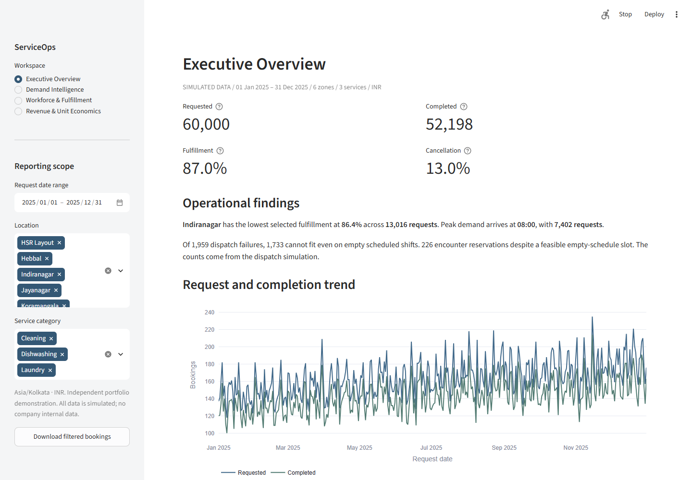

# ServiceOps Intelligence

This project analyzes simulated bookings for a hyperlocal home-services marketplace. It uses SQLite and pandas to compare demand, available shifts, fulfillment, and contribution across six service zones.

## Business problem

- When do requests arrive, and which zones have lower fulfillment?
- Why do dispatch failures occur when the schedule has spare hours?
- What changes when the same requests are replayed against different shifts?
- Which services and zones contribute the most after attributable costs?

## Dataset and assumptions

The seed-42 generator creates 60,000 requests for January to December 2025. The baseline models 108 workers across six zones. Workers serve their own zone, and an assignment must fit the full service within a shift. The reporting timezone is Asia/Kolkata. The [data and model notes](reports/data_provenance.md) describe the tables and assignment rules.

## SQL and Python analysis

- **SQLite** runs 12 queries covering trends, cancellations, delays, utilization, repeat customers, and service economics.
- **Python and pandas** calculate request-cohort KPIs and allocate service and reservation time to hourly intervals.
- **Streamlit and Plotly** provide date, zone, and service filters plus booking and hourly capacity CSV downloads.
- **Excel** reports monthly, zone, service, worker, hourly, and scenario summaries. The Definitions sheet documents denominators.

Fulfillment divides completed bookings by requests. Revenue uses completed service charges from the selected request cohort. Contribution deducts worker payouts, materials, and processing fees. Service utilization counts completed service minutes, while occupied utilization also counts travel, accepted cancellations, and turnaround. Both divide by available shift minutes.

## Streamlit dashboard

Desktop captures from the final Streamlit browser check.



[Demand](assets/dashboard-demand.png) · [Workforce](assets/dashboard-workforce.png) · [Revenue](assets/dashboard-revenue.png)

390 px viewport: [Executive](assets/dashboard-mobile-executive.png) · [Demand](assets/dashboard-mobile-demand.png) · [Workforce](assets/dashboard-mobile-workforce.png) · [Revenue](assets/dashboard-mobile-revenue.png)

## Key findings

The baseline completed 52,198 requests (87.00% fulfillment) and recorded ₹17,211,937 in simulated revenue and ₹10,058,501.88 in contribution. Service utilization was 18.66%, and occupied utilization was 25.59%. Shift-window restrictions accounted for 1,733 of 1,959 simulated dispatch failures. Each of those requests arrived from 19:00 through 20:59.

| Schedule replay | Shift hours | Completed requests | Fulfillment |
|---|---:|---:|---:|
| Baseline | 255,488 | 52,198 | 87.00% |
| Move late shifts to 14:00–22:00 | 255,488 | 53,774 | 89.62% |
| Lean morning and evening split | 142,328 | 33,943 | 56.57% |

The replays use the same requests and worker attendance inputs. See the [analysis notes](reports/business_insights.md) for definitions and interpretation.

## Excel reporting automation

The exporter builds the workbook from Python summaries. It writes formulas for fulfillment, cancellation, average booking value and utilization. Open the generated workbook in Excel to recalculate the formulas.

## Data validation

Tests cover record integrity, SQL and Python reconciliation, hourly capacity, staffing replays, workbook formulas and Streamlit filters. See the [verification notes](reports/verification.md) for browser coverage.

## Setup and execution

Use Python 3.11 or newer. Run these commands from the project folder. Build creates the baseline if needed and refreshes the SQL results, staffing replays, and workbook inputs. The Excel refresh writes formulas that Excel recalculates when opened.

```powershell
python -m venv .venv
.\.venv\Scripts\python.exe -m pip install -r requirements.txt
.\.venv\Scripts\python.exe -m src.build
.\.venv\Scripts\python.exe -m src.excel_export
.\.venv\Scripts\python.exe -m pytest -q
.\.venv\Scripts\python.exe -m streamlit run dashboard/app.py --server.address 127.0.0.1
```

Open [localhost:8501](http://127.0.0.1:8501). The source lives in `src/`, the queries in `sql/`, the dashboard in `dashboard/`, and the checks in `tests/`.

## Limitations

Demand, travel, worker attendance and cancellations follow synthetic assumptions. The schedule comparisons depend on those assumptions and do not estimate real-world effects. The model excludes explicit breaks, cross-zone routing, guaranteed wages, refunds, taxes and overhead. Contribution therefore covers only the modeled attributable costs.
